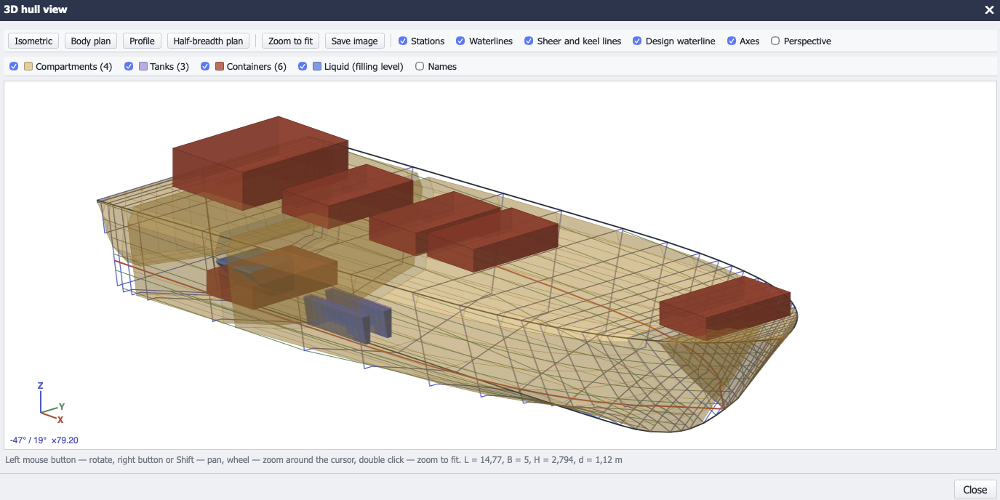
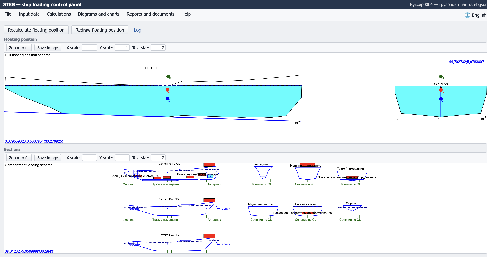
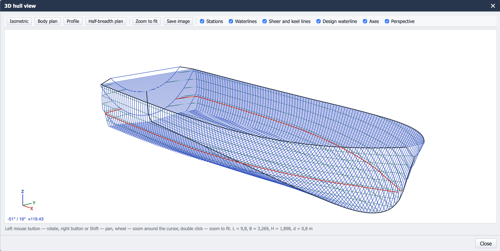
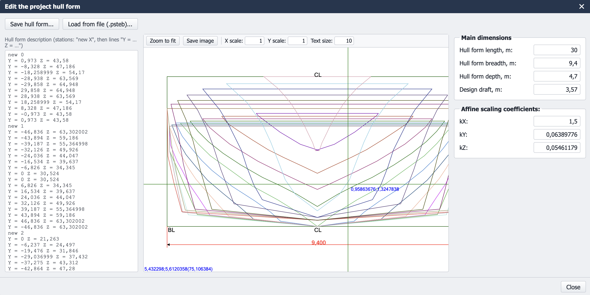
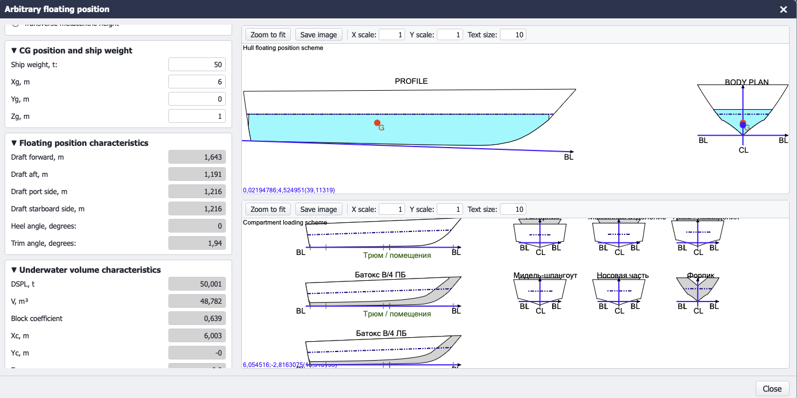
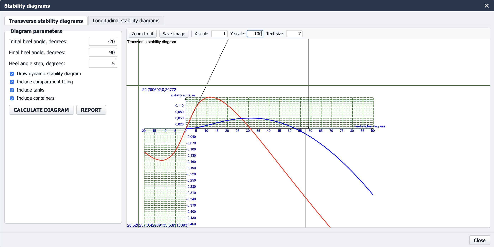
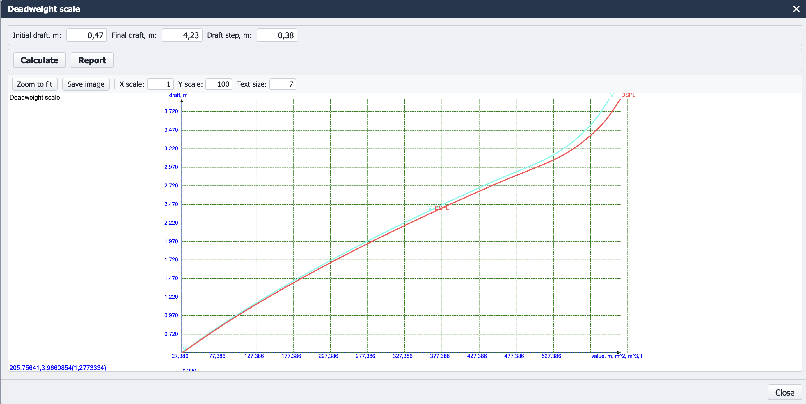
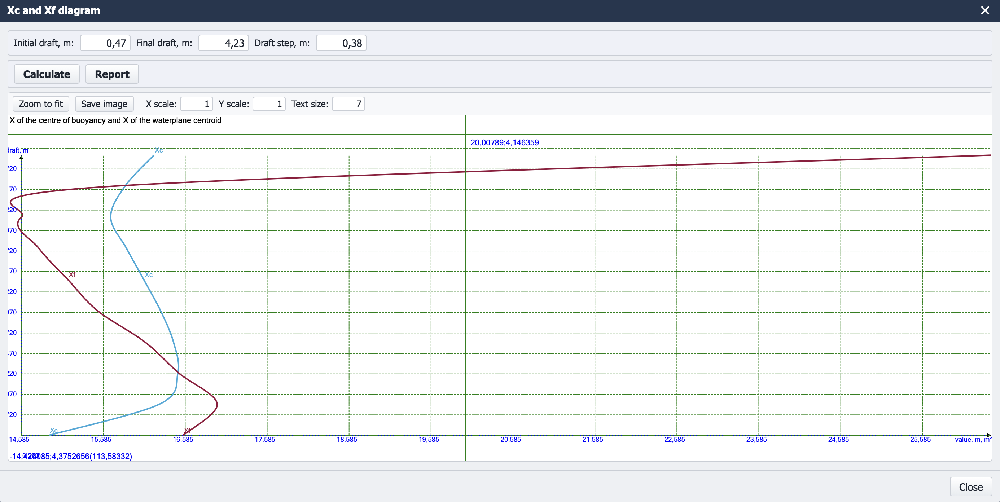
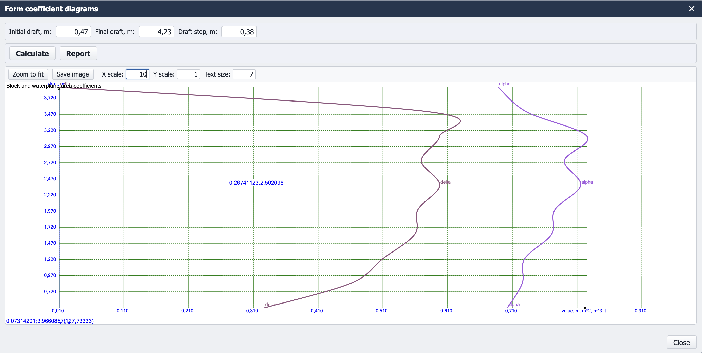
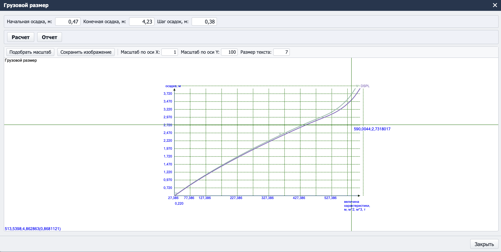

# STEB — Ship Theory Electronic Book (floating position & stability, teaching software)

[](LICENSE)


**STEB** (*Ship Theory Electronic Book*) calculates how a ship floats under different loading conditions: draft, heel and trim,
hydrostatic curves, stability diagrams, cargo, tanks and flooded compartments.
It was written in 2009–2010 as a diploma project. It runs in a browser on Windows, macOS and Linux (.NET 10 / ASP.NET Core Blazor Server).

> ⚠️ **For educational purposes only.** STEB is a teaching tool for ship theory.
> It is not approved or certified software and must not be used to design, approve or operate real vessels.
> It is provided "as is", without any warranty, and the author accepts no liability for its use or results.
> See [DISCLAIMER.md](DISCLAIMER.md).

**3D hull view** — hull lines with compartments, tanks and cargo as shaded solids and the liquid at its filling level;
rotate, pan and zoom with the mouse:



## Contents

* [Features](#features)
* [Screenshots](#screenshots)
* [User guide](#user-guide)
* [Repository layout](#repository-layout)
* [Build, run and test](#build-run-and-test)
* [Language](#language)
* [Known differences from the 2010 program](#known-differences-from-the-2010-program)
* [Extending and contributing](#extending-and-contributing)
* [Purpose and disclaimer](#purpose-and-disclaimer)
* [License](#license)
* [Author](#author)

## Features

### Projects
* Start page with a project browser: search, filters by load case, projects grouped by ship.
* Create an empty project, create one from a prototype (copy of any project), save as, download the project file.
* Ready-to-open examples: NIY-10 plus three load cases for each of 25 hull prototypes
  (tugs, boats, a catamaran, icebreakers, container ships, timber and bulk carriers, Ro-Ro, reefers, barge carriers):
  *loading plan*, *cargo shift* (a movable weight to play with) and *compartment flooding* (a damaged side compartment).

### Input data
* **Hull form editor** — stations as text (`new X`, then `Y = … Z = …` points; `mirror` for symmetric sections),
  load a `.psteb` prototype, live body-plan drawing with centreline/baseline and breadth dimension.
* **3D hull view** — stations, waterlines, sheer and keel lines and the design waterline in 3D: rotate with the mouse,
  pan, zoom around the cursor, standard views (isometric, body plan, profile, half-breadth), perspective, save as PNG.
  Compartments, tanks and cargo are shown as shaded transparent solids, with the liquid filled up to its level.
* **Main dimensions** (length, breadth, depth, design draft) and affine scaling coefficients kX, kY, kZ.
* **Transverse and longitudinal sections** to draw, each with its own label (e.g. frames, centreline section, buttocks).
* **Water areas** with density (sea water, fresh water, …).
* **Lightship mass and centre of gravity** (Xg, Yg, Zg).
* **Compartments** — position, size, filling %, liquid density and permeability; the shape is clipped by the hull.
* **Tanks** — name, shape, position box, liquid density and filling; calculated and maximum volume, weight and liquid level.
* **Containers / cargo items** — mass, size and position.

### Floating position
* Control panel with two live drawings:
  * **Hull floating position scheme** — profile and body plan with the waterline, submerged volume and the
    centre of gravity (G), centre of buoyancy (C) and metacentre (M);
  * **Compartment loading scheme** — longitudinal and transverse sections showing compartments, tanks and cargo.
* Draft, heel and trim found from the current loading (lightship + cargo + tanks + flooded compartments).
* **Arbitrary floating position** — determine the floating position by any of 16 sets of known values
  (weight and CG; drafts forward/aft/port/starboard; midship draft, heel and trim; displacement or volume with heel
  and trim; block or waterplane coefficient; metacentric radii or heights; centre of buoyancy; waterplane centroid;
  waterplane moments of inertia) and get all other characteristics.

### Diagrams
* **Deadweight scale** — volume and displacement versus draft.
* **Xc and Xf** — longitudinal centre of buoyancy and of the waterplane versus draft.
* **r and Zc** — transverse metacentric radius and height of the centre of buoyancy versus draft.
* **Form coefficients** — block (δ) and waterplane (α) coefficients versus draft.
* **Static and dynamic stability diagrams**, transverse and longitudinal, for any range and step of heel angles,
  optionally including compartment filling, tanks and containers.
* **Form stability arms (cross curves / pantocarenes).**
* **Polar (circular) stability diagram** for spatial inclinations.
* Every diagram: zoom with the mouse wheel, pan by dragging, fit to window, X/Y scale and text size,
  cursor coordinates, save as SVG; ranges and steps of drafts or angles are set per diagram.

### Reports
* **Hydrostatics table** for a list or range of drafts, underwater volumes or displacements.
* **Floating position report** — drafts, heel and trim, displacement, centres, waterplane characteristics,
  metacentric radii and heights.
* Reports for each diagram; all reports can be printed or downloaded as HTML.

### Interface
* Runs in the browser (ASP.NET Core Blazor Server); menus and windows follow the 2010 desktop program.
* Five languages: English, Русский, Español, Français, Türkçe — a global setting in the 🌐 menu.
* Log of calculation messages and a progress box for long calculations.

## Screenshots

**Control panel** — floating position (profile and body plan with G, C, M) and the compartment loading scheme:



**3D hull lines** — stations, waterlines, sheer/keel lines and the design waterline:



**Hull form editor** — station text, body plan, main dimensions and affine scaling:



**Arbitrary floating position** — choose what is known (here ship weight and CG), get drafts, heel, trim and all
hydrostatic characteristics, with the floating position and the compartment loading scheme drawn:



**Stability diagrams** — static and dynamic transverse stability with loading options:



| Deadweight scale | Xc and Xf diagram |
|---|---|
|  |  |

| Form coefficients | Russian interface (deadweight scale) |
|---|---|
|  |  |

## User guide

Step-by-step instructions for every module are in **[docs/USER_GUIDE.md](docs/USER_GUIDE.md)**:
projects, control panel, hull form editor, sections, water areas, lightship, compartments, tanks, cargo,
arbitrary floating position, each diagram, reports, language, and a sample exercise.

Quick tips for drawings and diagrams:

* **X scale** and **Y scale** stretch a drawing along one axis only — essential when the axes have different ranges
  (e.g. **Y scale = 100** on the deadweight scale, **X scale = 10** for form coefficients); then press **Zoom to fit**.
* **Mouse wheel** zooms, **dragging** pans, the crosshair shows the coordinates under the cursor.
* **Text size** changes the size of labels; **Save image** downloads the drawing as SVG.
* **3D hull view** (*Input data → 3D hull view*): left drag rotates, right drag or Shift+drag pans, the wheel zooms
  around the cursor, double click fits; buttons switch to isometric, body plan, profile and half-breadth views.
* Scales change only the picture, never the results.

> **Rule of the port:** the calculation and data logic is kept exactly as recovered from the 2010 build.
> Only the parts tied to the old framework (WinForms, GDI+, Access/OleDb) were replaced. Details: [`src/README.md`](src/README.md).

## Repository layout

| Path | Contents |
|---|---|
| `src/STEB.sln` | Solution with all projects below |
| `src/STEB.Core` | Calculation engine (geometry, hydrostatics, stability, masses, tanks, compartments) and the JSON project-file provider |
| `src/STEB.Compat` | Minimal cross-platform stand-ins for the `System.Drawing` / WinForms types the original code uses (drawing goes to SVG) |
| `src/STEB.Web` | Blazor Server application (originally the desktop program `STEB_LOAD.exe`) |
| `src/STEB.Web/Projects` | Example projects (`*.xsteb.json`) |
| `src/STEB.Web/Resources/i18n.json` | Interface translations (key = original Russian text) |
| `src/tests/STEB.Core.Tests` | xUnit tests of the engine and data layer |
| `LICENSE`, `DISCLAIMER.md` | License and educational-use disclaimer |

## Build, run and test

**Prerequisites:** [.NET 10 SDK](https://dotnet.microsoft.com/download) (`dotnet --version` prints `10.x`) and a modern browser.
Optional IDE: JetBrains Rider, Visual Studio 2022 17.14+ or VS Code with C# Dev Kit.

```bash
git clone https://github.com/chesdenis/steb.git
cd steb

dotnet build src/STEB.sln                      # build
dotnet run --project src/STEB.Web         # run, then open http://localhost:5180
dotnet test src/STEB.sln                       # all tests
dotnet test src/STEB.sln --filter "Category!=Slow"            # fast tests only
dotnet test src/STEB.sln --collect:"XPlat Code Coverage"      # with coverage (TestResults/)
```

The app listens on **http://localhost:5180**.

**First steps:** on the start page open a case, e.g. the **cargo shift** case of NIY-10. The control panel shows the
floating position and the hull sections. Change the loading under *Input data*, see curves under
*Diagrams and charts*, print reports from *Reports and documents*.

Projects you create are saved in `src/STEB.Web/Projects/`. One running server works with one project at a time
(the engine keeps the open project in a static field, as the desktop program did), so each user runs their own copy.

### What the tests cover

| Test class | Area |
|---|---|
| `ConvertingTests` | Number parsing used by all input fields (`,` and `.` decimals, `null`, original quirks) |
| `StationTextTests` | Hull/tank description format (`new X`, `mirror`, contour closing, merged stations) |
| `GeometryTests` | Vector maths, bounding boxes, hull dimensions, scaling a shape to L/B/H |
| `HydrostaticsTests` | Volume, displacement, centre of buoyancy, waterplane, metacentric radius and draft from volume against closed-form results for a box barge and a wedge; free-floating equilibrium |
| `MassAndLoadTests` | Lightship + containers + tanks + flooded compartments → total mass and centre of gravity; tank and compartment volumes; clipping a compartment by the hull |
| `JsonDatabaseTests` | The JSON project-file provider: the SQL the program sends, autonumber, primary key, decimal commas, saving to disk |

The tests follow the **FIRST** principles: **F**ast (small analytical hulls; the one search-based test is tagged `Slow`),
**I**ndependent (each test builds its own input; database tests use their own temporary file),
**R**epeatable (no clock, network, randomness or machine paths), **S**elf-validating (assertions against exact or
closed-form values) and **T**imely (they pin the recovered behaviour so any change to results is caught).

## Language

Pick the interface language in the 🌐 menu on the right of the menu bar: English (default), Русский, Español,
Français or Türkçe. It is a global setting for the whole app, saved in `src/STEB.Web/settings.json`.

Menus, windows, grid headers, drawings, reports and the log are translated. Names stored in project files
(compartments, tanks, cargo items) are data and stay as entered. Numbers keep the original format (decimal comma),
so calculations and stored values are unaffected. To add or correct a translation, edit `Resources/i18n.json` and restart.

## Known differences from the 2010 program

* Floating-point numbers are printed with modern .NET formatting, so the last digits in reports can differ.
* Drawings are SVG; text size is approximated.

## Extending and contributing

Forks and extensions are welcome — new criteria, reports, hull forms, languages.

* Keep changes to the recovered engine (`src/STEB.Core`) separate from new features, and cover calculation changes with tests.
* Translations: add the language to `L.Languages` in `src/STEB.Web/Services/Localization.cs` and a text for its code to each entry in `Resources/i18n.json`.
* Pull requests with fixes, tests and translation corrections are welcome.

## Purpose and disclaimer

This project is published **for educational purposes**: to learn floating-position, hydrostatics and stability
calculations and to extend, experiment with and fork the code.

It is **not** intended for the design, approval, certification or operation of real ships, nor for any governmental,
commercial or safety-critical use. The calculations have not been verified against classification society rules or
IMO/national stability criteria, and the example projects contain approximated, illustrative data.

The software is provided **"as is", without warranty of any kind**. Results may be incorrect; users are solely
responsible for checking them. The author and contributors accept **no responsibility or liability** for any use or
misuse of the software or its results. Full text: [DISCLAIMER.md](DISCLAIMER.md).

## License

Released under the [MIT License](LICENSE) — Copyright © 2010, 2026 Denis Chesnokov.

You may use, copy, modify, fork and redistribute the code and the example projects, including in your own projects,
provided the copyright and license notice are kept. The license's warranty and liability disclaimer applies in full;
see also [DISCLAIMER.md](DISCLAIMER.md).

The application uses only the .NET runtime. Test-only packages: xUnit (Apache-2.0), Microsoft.NET.Test.Sdk (MIT),
coverlet (MIT).

## Author

**Denis Chesnokov** — original program (2009–2010) and the 2026 recovery and port.

* GitHub: [github.com/chesdenis](https://github.com/chesdenis)
* LinkedIn: [linkedin.com/in/denis-chesnokov-aa3646183](https://www.linkedin.com/in/denis-chesnokov-aa3646183)
