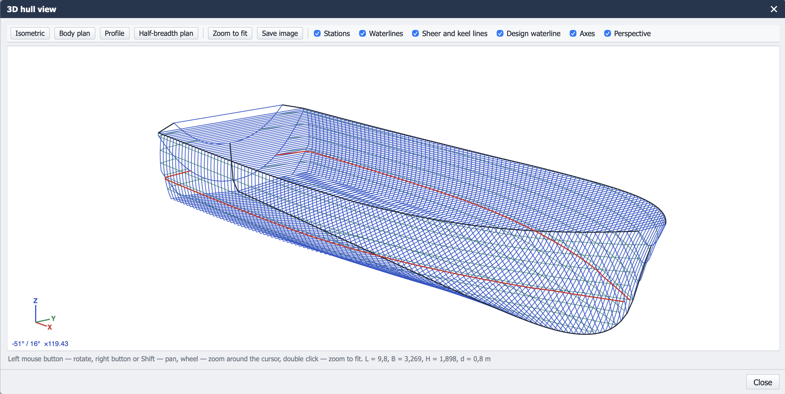

# STEB — user guide

How to work with each part of the program. Menu and button names are given as they appear in the English
interface (the language can be switched in the 🌐 menu, top right).

> STEB is for education only — see [DISCLAIMER.md](../DISCLAIMER.md).

* [General rules](#general-rules)
* [Working with drawings and diagrams (scaling per axis, zoom, export)](#working-with-drawings-and-diagrams)
* [Projects (File)](#projects-file)
* [Control panel](#control-panel)
* [Input data](#input-data)
* [Calculations: arbitrary floating position](#calculations-arbitrary-floating-position)
* [Diagrams and charts](#diagrams-and-charts)
* [Reports and documents](#reports-and-documents)
* [Language](#language)
* [A typical exercise](#a-typical-exercise)

## General rules

* **Numbers** may be typed with a decimal comma or a point (`12,5` and `12.5` are the same). Only digits, `,` `.` and `-` are accepted in numeric fields.
* A value is applied when you **press Enter or leave the field** (Tab or click elsewhere). Many windows then recalculate and redraw at once.
* **Grids** (compartments, cargo) save every edited cell to the project immediately. *Add row* appends an empty row; *delete* removes one.
* **White fields** are inputs; grey fields are results calculated by the program.
* Everything is saved in the project file automatically — there is no separate *Save* step. Use *Save as* to keep a copy.
* Units: metres, tonnes, cubic metres, t/m³, degrees.
* Coordinate system: **X** along the length (from the aft end of the hull form), **Y** across (from the centreline), **Z** up (from the baseline).

## Working with drawings and diagrams

Every drawing (hull, floating position, sections, tanks, all diagrams) has the same toolbar and mouse controls:

| Control | What it does |
|---|---|
| **Zoom to fit** | Fits the whole drawing into the window. Use it after changing scales or when the drawing is off-screen. |
| **Save image** | Downloads the drawing as an **SVG** file (vector; opens in any browser, Inkscape, Illustrator, Word, PowerPoint). |
| **X scale** | Stretches or compresses the drawing **horizontally only**. |
| **Y scale** | Stretches or compresses the drawing **vertically only**. |
| **Text size** | Size of all labels and axis values on the drawing. |
| Mouse wheel | Zoom in/out around the cursor. |
| Drag with the mouse | Move (pan) the drawing. |
| Cursor | The crosshair shows the coordinates under the cursor in drawing units (e.g. tonnes;metres on the deadweight scale). The line at the bottom left shows the view position and zoom. |

**Why per-axis scaling matters.** Diagram axes often have very different ranges — for example the deadweight
scale plots displacement in hundreds of tonnes against drafts of a few metres. With equal scales the curve is a
flat line. Set **Y scale = 100** (or X scale = 0.01) and press **Zoom to fit** to get a readable chart. The same
helps for form coefficients (values 0…1 against drafts in metres: try **X scale = 10**) and stability arms
(tenths of a metre against degrees: try **Y scale = 100**). Typical starting points:

| Diagram | Suggested scale |
|---|---|
| Deadweight scale, cross curves | Y scale 100 |
| Xc and Xf, r and Zc | 1 / 1 (adjust if one axis is cramped) |
| Form coefficients | X scale 10 |
| Stability diagrams | Y scale 50–100 |
| Hull form, floating position, sections | 1 / 1 (true shape); Y > 1 exaggerates the vertical for shallow hulls |

Scales change only the picture, never the calculation. Increase **Text size** when labels overlap after zooming out.

## Projects (File)

The start page (*Open…*) lists all projects in `src/STEB.Web/Projects/`, grouped by ship.

* **Search** filters by ship or project name; the **chips** filter by load case (*loading plan*, *cargo shift*, *compartment flooding*, other).
* Click a **case button** to open that project. The currently open one is highlighted.
* **⧉** next to a case selects it as a prototype (opens *Create from prototype*).
* **New…** — creates an empty project and opens the hull form editor.
* **Create from prototype…** — copies the selected project under a new name; good for making your own variant of an example.
* **Save as…** — saves the open project under a new name and continues with the copy.
* **Download project file** — downloads the open project (`.xsteb.json`) to share or back up. To use a downloaded file
  again, put it into the `Projects` folder.

## Control panel

Opens after a project is loaded. It shows two drawings:

* **Hull floating position scheme** — profile (*PROFILE*) and body plan (*BODY PLAN*) of the hull at the calculated
  draft, heel and trim, with the submerged part filled, the waterline, baseline (BL), centreline (CL), and the points
  **G** (centre of gravity), **C** (centre of buoyancy) and **M** (metacentre).
* **Compartment loading scheme** — the longitudinal and transverse sections chosen in *Input data*, with compartments,
  tanks and cargo items drawn inside.

Buttons:

* **Recalculate floating position** — runs the calculation again from the current loading (lightship + cargo + tanks + flooded compartments).
* **Redraw floating position** — redraws both schemes without recalculating.
* **Log** — shows calculation messages (e.g. when a floating position cannot be found for the given loading).

Long calculations show a progress box with the current step.

## Input data

### Edit hull form

* Left: the **hull form description** — theoretical stations, one block per station:
  ```
  new 0
  Y = 0 Z = 0
  Y = 1,2 Z = 0,3
  Y = 1,8 Z = 1,5
  new 1
  ...
  ```
  `new X` starts a station at longitudinal position X; each line is a point (Y, Z) of its contour. The labels
  `Y =`/`Z =` are optional — any pairs of numbers work. Write `new X mirror` and give only one side to get a
  symmetric section. Several blocks with the same X form one station with several contours (e.g. catamaran hulls).
* **Load from file (.psteb)…** reads a hull prototype text file; you can also paste text directly.
* Middle: the **body plan drawing** updates as you type (all stations overlaid, with CL, BL and breadth).
* Right — **Main dimensions**: hull form length, breadth, depth and design draft. When length, breadth and depth are
  all greater than zero, the shape is scaled to exactly these dimensions, so a prototype drawn in any units
  (e.g. millimetres) becomes a hull of the required size. The **affine scaling coefficients kX, kY, kZ** show the
  resulting scale factors; when the dimensions are zero they are used directly.
* **Save hull form…** writes the description into the project. Close the window to recalculate the floating position.

### 3D hull view

Shows the saved hull form of the project in three dimensions (it only displays — nothing is changed):



* **Stations** (blue), **waterlines** (green, horizontal cuts at regular heights), **sheer and keel lines** (dark) and
  the **design waterline** at the design draft *d* (red). Each layer can be switched on and off; **Axes** shows the X/Y/Z triad.
* **Left mouse button** — rotate around the hull; **right button** or **Shift + drag** — pan;
  **mouse wheel** — zoom around the point under the cursor; **double click** — fit the hull into the window.
* **Compartments** (orange), **tanks** (purple) and **cargo items** (red) are drawn as shaded, semi-transparent
  solids. Compartments are cut by the hull exactly as in the calculation; tanks use their own shape. The **liquid**
  (blue) fills each compartment or tank up to the level that corresponds to its filling %, with the ship upright —
  a flooded compartment shows its water, a half-full tank its liquid surface. The second toolbar row switches each
  group on and off (the number of items is shown) and **Names** labels every solid with its name and filling.
  Faces are shaded by their angle to the light, so the shape reads clearly while rotating.
* Standard views: **Isometric**, **Body plan** (looking along the hull), **Profile** (side) and **Half-breadth plan** (top).
* **Perspective** switches from parallel projection to a perspective view.
* **Save image** downloads the current view as PNG.
* The line at the bottom left shows the current rotation (yaw / pitch, in degrees) and zoom; the hint under the view
  shows the main dimensions L, B, H and the design draft d.

How the view works: every point (x, y, z) is turned by a rotation matrix (yaw around the vertical Z axis, then pitch
around the screen's horizontal axis) and then mapped to the screen by a view matrix (scale and offset). Zooming
changes the scale while moving the offset so the point under the cursor stays in place; panning changes only the
offset; rotating keeps the centre of the hull fixed on screen. Perspective additionally divides by the distance from the viewer.

Tips:

* Use **Body plan** to compare the stations with the hull form editor, **Profile** to check the sheer and keel,
  **Half-breadth plan** to see how the waterlines run.
* Turn off **Stations** to see the waterlines alone — the usual "lines plan" view of a hull.
* Turn off **Perspective** for measurements and screenshots in standard views; turn it on for presentations.

The view uses the same stations as the calculations (scaled to the main dimensions), so save the hull form first
in *Edit hull form* to see your latest changes.

### Transverse sections / Longitudinal sections

Choose which sections appear in the compartment loading scheme. One section per line: `coordinate:label;`, e.g.

```
4,5:Midship;
0:Centreline section;
```

For transverse sections the coordinate is X (along the length); for longitudinal sections it is Y (distance from the
centreline; positive and negative for the two sides). Changes are saved when you leave the field.

### Edit water areas

A list of water areas with their density (e.g. sea water 1,025 t/m³, fresh water 1,000 t/m³).
**Add water area** asks for a name and density; select a row and **Delete water area** to remove it.
The **first water area in the list** is used for all calculations.

### Lightship mass and CG

Ship weight (t) and the centre of gravity Xg, Yg, Zg (m) of the empty ship. Values apply on Enter or when leaving a field.

### Compartments

A grid, one row per compartment:

| Column | Meaning |
|---|---|
| Name | Compartment name (shown in the loading scheme) |
| x0, x1 | Start and end along the length, m |
| y0, y1 | Start and end across the breadth, m |
| z0, z1 | Bottom and top, m |
| Density | Density of the liquid that can fill the compartment, t/m³ (e.g. 1,025 for sea water when flooded) |
| Filling, % | How full the compartment is: 0 = empty, 100 = full |
| k | Permeability, 0…1 (share of the volume that can be filled; e.g. 0,85 for an engine room) |

The box is cut by the hull surface, so a compartment wider than the hull only counts the part inside it.
To simulate **damage**, set filling to e.g. 100 % with sea-water density and close the window: the floating position
is recalculated with the water inside.

### Tanks

The list shows each tank with its density, maximum and calculated volume and mass, and liquid level.

* **Add new tank** opens the tank parameters; **Edit tank parameters** opens them for the selected tank; **Delete tank** removes it (after confirmation).
* In the parameters window: name, liquid density, **% filling**, and the tank box **x0…x1, y0…y1, z0…z1**.
  The calculated volume, liquid weight and level and the maximum volume and weight update immediately; you can also
  type the calculated volume or weight instead of the percentage.
* The **tank shape** is described like the hull (`new X` + points). The default is a rectangular prism; any shape is
  scaled into the box. The drawing on the right shows the tank and the liquid level.
* When you close the window, confirm to apply the changes.

### Containers

Cargo items as boxes: name, size **l, b, h** (m), position **x, y, z** (m) and **mass** (t). The weight acts at the
centre of the box. To practise a **cargo shift**, change x, y or z of an item and watch heel and trim change.

## Calculations: arbitrary floating position

Explore the relations between hydrostatic characteristics in reverse.

1. Under **Determine floating position by**, choose one of 16 methods — e.g. *Ship weight and CG coordinates*,
   *Forward, aft, port and starboard drafts*, *Displacement, heel angle and trim angle*, *Block coefficient*, *Transverse metacentric height*…
2. The fields that belong to the chosen method turn **white** — type their values.
3. Press **Enter** in any field or **Calculate (Enter)**.
4. All other characteristics are filled in: drafts, heel and trim, displacement and volume, centre of buoyancy,
   metacentric radii and heights, waterplane coefficient, centroid and moments of inertia.
   Both drawings show the resulting floating position.

## Diagrams and charts

All diagram windows work the same way: set the range, press **Calculate**, adjust the view with the
[drawing toolbar](#working-with-drawings-and-diagrams), and press **Report** for a printable table of the plotted values.

| Diagram | Range to set | What is plotted |
|---|---|---|
| **Deadweight scale** | initial draft, final draft, draft step (m) | underwater volume V and displacement DSPL versus draft |
| **Xc and Xf diagram** | drafts as above | longitudinal centre of buoyancy Xc and waterplane centroid Xf versus draft |
| **r and Zc diagram** | drafts as above | transverse metacentric radius r and height of the centre of buoyancy Zc versus draft |
| **Form coefficient diagrams** | drafts as above | block coefficient δ (delta) and waterplane coefficient α (alpha) versus draft |
| **Stability diagrams** | initial and final heel angle, step (degrees) | static stability arms (righting-arm curve) and, optionally, the dynamic stability diagram |
| **Form stability arms diagram** (cross curves) | displacement range and step (t), heel angles | form stability arms for each heel angle versus displacement |
| **Polar stability diagram** | ranges and steps of the inclination direction angle and the spatial inclination angle | stability for inclinations in any direction, not only heel or trim |

Notes on the **stability diagrams** window:

* Two tabs: **transverse** (heel) and **longitudinal** (trim).
* Check boxes: **draw dynamic stability diagram**, and whether to **include compartment filling, tanks and containers** in the ship's weight.
* **CALCULATE DIAGRAM** draws the curves; **REPORT** opens the report.
* The diagram uses the current loading, so change the input data first and then recalculate.

Default draft ranges are taken from the hull (from a small draft up to just below the depth); change them as needed.

## Reports and documents

* **Hydrostatics report** — enter drafts, underwater volumes or displacements, as
  comma-separated values or as a range `start, next...end` (e.g. `0.5, 1...3` = 0.5, 1, 1.5 … 3; use points as
  decimal separators here, because the comma separates the values). Press **Calculate** to get
  tables of all hydrostatic characteristics.
* **Floating position report** — a report on the current floating position: drafts, heel, trim,
  displacement, centre of gravity and buoyancy, waterplane characteristics, metacentric radii and heights, with drawings.

In every report window: **Print** prints the report (or saves it as PDF through the browser print dialog);
**Download report (.html)** saves a self-contained HTML file with the drawings embedded.

## Language

Choose the interface language in the 🌐 menu (top right): English, Русский, Español, Français, Türkçe. The page reloads
in the new language. The choice is global for the running server and is remembered after a restart.
Names typed into projects (compartments, tanks, cargo) are not translated.

## A typical exercise

1. Open the **cargo shift** case of NIY-10 from the start page.
2. Look at the control panel: note the drafts, heel and the positions of G, C and M.
3. *Input data → Containers*: move the movable cargo item (the one whose name says to change x, y, z) by changing its **y**, close the window.
4. Compare the new heel with the hand calculation tan θ = m·Δy / (D·GM).
5. *Diagrams → Stability diagrams*: calculate the transverse diagram before and after the shift and compare the curves.
6. *Reports → Floating position report*: print the result for your notes.

For flooding, open a **compartment flooding** case and change the filling of the damaged compartment in *Input data → Compartments*.
